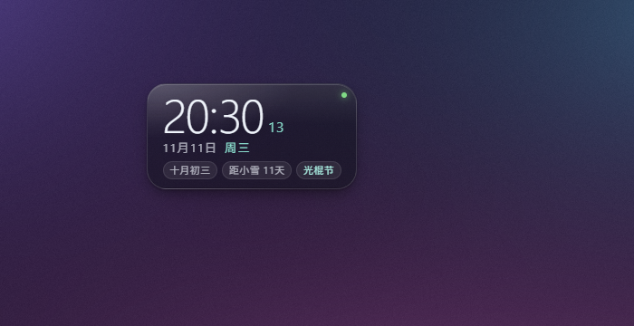
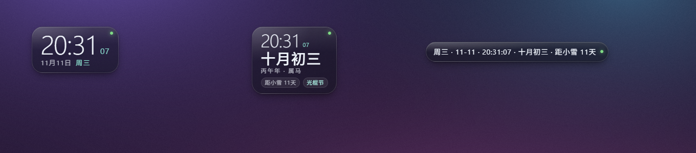
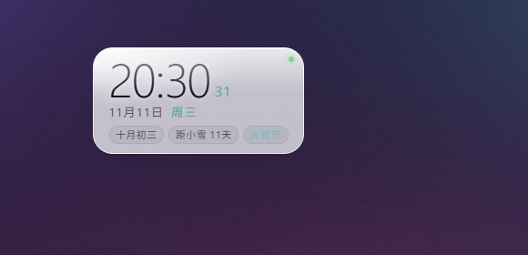
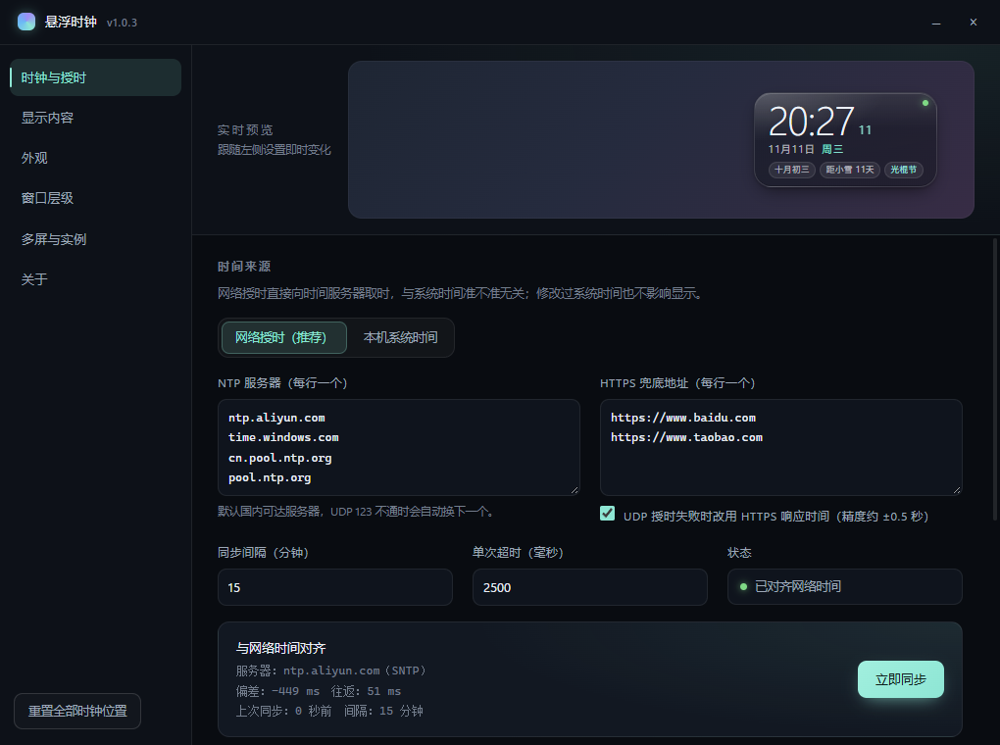

# 悬浮时钟 · Desktop Clock Widget

一个 Windows 上的半透明桌面悬浮时钟：**SNTP 网络授时自动对齐**、**可手动选择时区**、
**始终置顶 / 固定在桌面层**两种层级、内置**农历、二十四节气、法定节假日与调休**，
并且可以**同时开多个窗口分屏显示**（多显示器各放一个，各用不同的显示模式）。

适合把任务栏右下角的时钟隐藏之后，用一块更顺眼的浮动时钟代替它。



## 目录

- [功能特性](#功能特性)
- [系统要求](#系统要求)
- [下载与安装](#下载与安装)
- [快速上手](#快速上手)
- [设置说明](#设置说明)
- [多显示器与多窗口](#多显示器与多窗口)
- [配置文件与数据](#配置文件与数据)
- [数据来源与许可](#数据来源与许可)
- [开发](#开发)
- [已知限制](#已知限制)
- [常见问题](#常见问题)
- [贡献](#贡献)
- [许可证](#许可证)

## 功能特性

**时间与授时**

- SNTP（UDP 123）直连 `ntp.aliyun.com`、`time.windows.com`、`cn.pool.ntp.org`、`pool.ntp.org`，
  多服务器取样后取往返延迟最小的一次，并在设置里显示真实偏差（毫秒）与往返延迟。
- UDP 被网络策略拦截时，自动回退到 HTTPS 响应时间（`Date` 头，精度约 ±0.5 秒）。
- 默认每 15 分钟自动重新对齐；检测到系统时间被手动改动（跳变 > 3 秒）会立刻重新同步。
- 托盘菜单 / 快捷键 `Ctrl+Alt+N` / 右键菜单都支持“立即同步”。
- 也可以切回“本机系统时间”，完全不联网。

**时区**

- 默认跟随系统时区；也可以固定成任意 IANA 时区（内置完整时区列表 + 北京/东京/纽约等快捷按钮）。
- 跨时区显示时，日期、星期、农历、节气都按所选时区的当地日期计算。

**显示内容**

| 版式 | 内容 |
| --- | --- |
| 极简时间 | 只有大号时间（秒可选） |
| 时间 · 日期 | 时间 + 日期 + 星期 |
| 完整信息 | 再加农历、节气、节日/假日、假日倒计时等标签 |
| 农历详情 | 农历大字 + 干支生肖 + 节气 + 标签 |
| 单行紧凑 | 一行显示：星期 · 日期 · 时间 · 农历 · 节气 |

元素开关可分别控制：日期、星期、秒、农历、节气、节日/假日、假日倒计时、干支生肖、时区标记、授时状态点。
支持 12/24 小时制、是否显示年份。



<sub>从左到右：时间 · 日期 / 农历详情 / 单行紧凑</sub>

**农历 / 节气 / 节假日**

- 农历日期（含闰月）、干支纪年、生肖。
- 二十四节气：当天是节气就高亮，否则显示“距小雪 11 天”。
- 法定节假日与调休：内置 2004–2027 年国务院放假安排，自动区分“放假”“调休”“补班”。
- 传统节日与常见节日（春节、端午、中秋、七夕、重阳、腊八、情人节、光棍节、圣诞…）。

**外观**

- 半透明玻璃面板：背景透明度 5%–100% 可调（文字始终清晰），玻璃描边 + 顶部高光由 CSS 绘制。
- 深色 / 浅色 / 跟随系统主题，8 种强调色 + 自定义颜色。
- 整体缩放 60%–300%（也可以直接在时钟上 `Ctrl + 滚轮`），字重、圆角、字体、文字阴影可调。
- 窗口尺寸随内容自适应，改字体/缩放后自动重排。



**层级与交互**

- **始终置顶**：浮在所有窗口上方，随时可见。
- **固定在桌面层**：普通层级窗口，不挡、不抢焦点，只在本来看得到桌面时出现。
- 鼠标点击穿透（透传给桌面/下层窗口）、锁定位置、拖动时吸附屏幕边缘。
- 右键菜单：切换显示模式、层级、锁定、穿透、隐藏、同步、设置、退出。
- 托盘图标：左键打开设置，右键是完整菜单；`Ctrl+Alt+T` 一键显示/隐藏全部时钟。
- 开机自启（可选）。

**多屏 / 多窗口**

- 每个窗口可以指定显示在哪块屏幕，并各自选择显示模式（例如主屏显示完整信息、副屏只显示时间）。
- “每块屏幕各放一个”一键铺满所有显示器。
- 窗口位置按窗口记忆，重启后保持；显示器被拔掉后会自动挪回可用屏幕。

## 系统要求

- Windows 10 21H2 及以上 / Windows 11（x64）
- 便携版无需安装任何运行时；从源码运行需要 Node.js 20+

## 下载与安装

### 便携版（推荐）

1. 在仓库的 **Releases** 页面下载最新的 `DesktopClock-win32-x64.zip`；
2. 解压到任意目录（例如 `D:\Tools\悬浮时钟\`）；
3. 双击 `DesktopClock.exe` 运行。

> 程序没有代码签名，首次运行 Windows 可能提示“Windows 已保护你的电脑”。
> 点 **更多信息 → 仍要运行** 即可；这是 SmartScreen 对所有未签名 exe 的默认行为。

也可以运行仓库根目录的 `启动悬浮时钟.vbs`：存在打包版时优先启动它，否则回退到源码运行。

### 从源码运行

```powershell
git clone <你的仓库地址>
cd desktop-clock-widget
npm install     # 安装 Electron，约 150 MB
npm start
```

如果双击/运行后没有任何窗口（多见于受限的终端环境或沙箱，Chromium 沙箱无法初始化）：

```powershell
.\node_modules\electron\dist\electron.exe --no-sandbox .
```

### 自己打包

```powershell
npm run dist
# 产物：build\DesktopClock-win32-x64\DesktopClock.exe
```

## 快速上手

| 操作 | 效果 |
| --- | --- |
| 按住左键拖动 | 移动时钟（位置自动记忆；锁定后失效） |
| 右键 | 快捷菜单：显示模式 / 层级 / 锁定 / 穿透 / 隐藏 / 同步 / 设置 |
| 双击 | 打开设置窗口 |
| Ctrl + 滚轮 | 现场缩放 |
| `Ctrl+Alt+T` | 显示 / 隐藏所有时钟 |
| `Ctrl+Alt+N` | 立即同步网络时间 |
| 托盘左键 / 双击 | 打开设置 |

## 设置说明

设置窗口分六页：

1. **时钟与授时** —— 时间源、NTP 服务器、同步间隔、超时、HTTPS 兜底、时区、时间格式。
2. **显示内容** —— 五种版式 + 元素开关。
3. **外观** —— 主题、强调色、面板不透明度、字体、缩放、字重、圆角、文字阴影。
4. **窗口层级** —— 始终置顶 / 桌面层、锁定、点击穿透、边缘吸附、开机自启、全局快捷键。
5. **多屏与实例** —— 每个窗口的名字、所在屏幕、显示模式、隐藏/删除；一键每屏一个。
6. **关于** —— 版本、数据目录、操作提示、数据来源。



## 多显示器与多窗口

- 在 **多屏与实例** 页点“+ 添加时钟窗口”，然后给它指定屏幕与版式；每个窗口的显示模式可以单独覆盖全局设置。
- “每块屏幕各放一个”会按当前显示器列表重建实例，适合多屏桌面一次性铺好。
- 窗口位置存在 `layout.json` 里，按窗口 id 记忆；`重置全部时钟位置` 会把它们放回主屏右下角。

## 配置文件与数据

| 内容 | 位置 |
| --- | --- |
| 设置 | `%APPDATA%\desktop-clock-widget\config.json` |
| 窗口位置 | `%APPDATA%\desktop-clock-widget\layout.json` |

设置窗口「关于」页可以直接打开该目录。配置文件是普通 JSON，改坏也不会崩：加载时会自动清洗非法值并回落到默认值。

节假日数据在 `src/data/holidays/<年份>.json`，格式为：

```json
{
  "holidays": { "2026-10-01": "National Day,国庆节,3" },
  "workdays": { "2026-09-20": "National Day,国庆节,3" },
  "inLieuDays": { "2026-10-06": "National Day,国庆节,3" }
}
```

2028 年及以后的官方放假安排公布后，把对应年份的 JSON 放进去即可继续显示（程序按年懒加载）。

## 数据来源与许可

- 农历、二十四节气、传统节日、干支：内置 [lunar-javascript](https://github.com/6tail/lunar-javascript)（MIT），
  位于 `src/vendor/lunar.js`，许可证见 `src/vendor/LICENSE-lunar-javascript.txt`。
- 法定节假日与调休：内置 [chinese-days](https://github.com/vsme/chinese-days)（MIT）整理的年度数据，
  许可证见 `src/vendor/LICENSE-chinese-days.txt`。
- 网络授时：SNTP（RFC 4330）；HTTPS 兜底读取响应头 `Date`。
- 本程序自身：[MIT](LICENSE)。

## 开发

```
clock-widget/
├─ src/
│  ├─ main/            Electron 主进程
│  │  ├─ main.js       应用装配、托盘、快捷键、IPC
│  │  ├─ config.js     配置默认值、清洗、持久化
│  │  ├─ clock.js      SNTP / HTTPS 授时与同步调度
│  │  ├─ windows.js    多窗口管理（多屏、层级、拖动、尺寸自适应）
│  │  └─ shell.js      app:// 协议与设置窗口
│  ├─ preload/         contextBridge 暴露的最小 API
│  ├─ renderer/
│  │  ├─ widget.*      悬浮时钟窗口
│  │  ├─ settings.*    设置窗口
│  │  └─ lib/          时区格式化、农历、节假日、视图渲染
│  ├─ data/holidays/   2004–2027 法定节假日数据
│  └─ vendor/          lunar-javascript（MIT）
├─ tests/              node:test 单元测试
└─ scripts/            图标生成、打包脚本
```

```powershell
npm test        # 15 个单元测试：农历/节气/时区换算/节假日数据/配置清洗/授时取样
npm run icons   # 重新生成托盘与应用图标（需要 Python + Pillow）
npm run dist    # 打包便携版
```

几个实现细节：

- 时钟窗口用 `transparent: true` 的无边框窗口，面板半透明由 CSS 完成，
  所以“面板不透明度”只影响背景、不影响文字。
- 渲染进程用 `performance.now()` 锚定主进程给出的网络时间，每秒对齐到整秒刷新，避免系统时钟跳变导致抖动。
- 窗口尺寸由渲染进程测量内容后回传主进程调整（`widget:size`），并保持右下角锚点，
  因此换字体、改缩放都不会把窗口撑出屏幕。
- 拖动是自己实现的（`pointerdown/move/up` → 主进程 `setBounds`），而不是 `-webkit-app-region`，
  这样右键菜单、点击穿透、跨屏拖动都能正常工作。
- 窗口四周留白（22px）必须大于投影的扩散距离，否则投影会被窗口边界裁出一条直边。

更细的约定见 [CONTRIBUTING.md](CONTRIBUTING.md)。

## 已知限制

- 仅支持 Windows：透明窗口、托盘、原生层级都是 Windows 行为，未在 macOS / Linux 上适配。
- **没有桌面背景模糊**：DWM 原生材质与透明窗口互斥，`backdrop-filter` 在部分驱动下会出现方形模糊块，
  因此玻璃效果只用半透明填充 + 描边实现（详见常见问题）。
- 节假日数据内置到 2027 年，之后需要自行补 JSON。
- 未做代码签名，首次运行会被 SmartScreen 拦截一次。
- 时间源只读，不修改系统时间。

## 常见问题

**Q：同步一直失败，状态点变红？**
说明 UDP 123 端口不通（部分公司网络/校园网会拦截）。设置里保持“HTTPS 兜底”开启即可拿到 ±0.5 秒精度的时间；
也可以把 NTP 服务器换成内网授时服务器。

**Q：时间比手机慢/快几百毫秒正常吗？**
正常。状态里显示的“偏差”就是本机系统时间与网络时间的差值，悬浮时钟显示的是对齐后的网络时间。

**Q：为什么没有“亚克力 / 毛玻璃”背景模糊？**
两个坑都踩过了，所以最终把背景模糊整个去掉了：

1. Windows 11 的 DWM 原生材质（`setBackgroundMaterial('acrylic')`）和透明窗口（`transparent: true`）冲突，
   整块窗口会退化成不透明的灰色矩形，圆角和透明全丢。
2. CSS 的 `backdrop-filter: blur()` 在部分显卡驱动下会把窗口背后的桌面真的模糊掉，
   但模糊区域被裁在**窗口矩形**里（比圆角卡片大一圈），亮色壁纸下就会出现明显的方形模糊边界。

现在面板只用“半透明填充 + 描边 + 顶部高光 + 柔和投影”实现玻璃观感，边缘干净、跨机器一致；
想要更“透”就把“面板不透明度”调低，让壁纸纹理自然透出来。

**Q：边缘在亮色壁纸上看起来还是有一点硬？**
把“面板不透明度”降到 20%–35%、圆角调到 36–48px，观感会更化开。
如果看到的是方形切边而不是卡片本身的圆角，说明跑的仍是旧版本，请确认“关于”页版本号。

**Q：桌面层模式下，时钟被应用窗口挡住了？**
这是“桌面层”的预期行为：它只在看得到桌面时出现，不会盖住任何应用窗口。需要一直可见就选“始终置顶”。

**Q：看不到时钟了怎么办？**
按 `Ctrl+Alt+T`，或点托盘图标 → “显示所有时钟”。也可能是打开了“点击穿透”，用托盘菜单关掉即可。

**Q：多显示器拔掉一块后时钟不见了？**
程序会检测显示器变化并把落在不存在屏幕上的窗口挪回主屏；也可以在设置里点“重置全部时钟位置”。

**Q：改成 2028 年后节假日不显示了？**
内置数据只到 2027 年，按上文格式补一份 `2028.json` 即可，不用改代码。

## 贡献

欢迎 issue 与 PR，细节见 [CONTRIBUTING.md](CONTRIBUTING.md)。
提交前请跑一遍 `npm test`，界面改动请附截图。
维护者的发布流程（建仓库、打 tag、发 Release）见 [docs/PUBLISHING.md](docs/PUBLISHING.md)。

## 许可证

[MIT](LICENSE) © 2026 悬浮时钟 contributors
